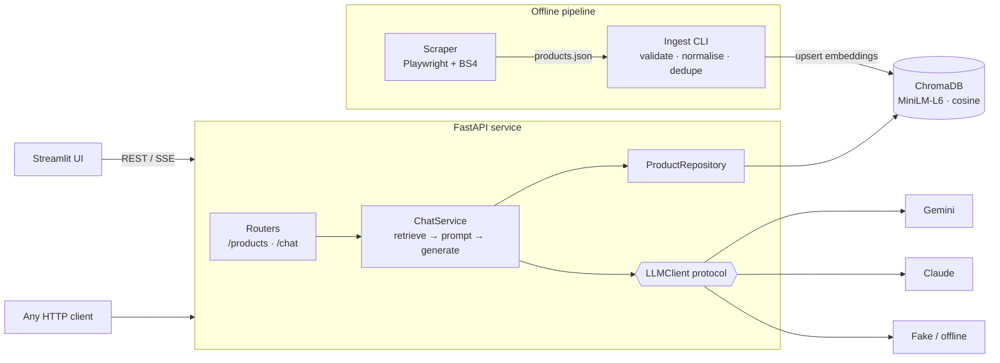

# 👖 ShopBot — RAG Shopping Assistant API

[](https://github.com/Sivakhon/LLM-Chatbot-for-website/actions/workflows/ci.yml)


A production-style **retrieval-augmented generation (RAG)** backend that answers shopping
questions over a product catalog scraped from [central.co.th](https://www.central.co.th/en/mc-jeans)
(MC Jeans). It is built as a real service: a typed FastAPI API, a vector store,
pluggable LLM providers, streaming responses, tests, Docker and CI. A Streamlit app is
included as a thin demo client.

> *"Black slim jeans for men under 1,500 baht?"* → retrieves matching products with
> metadata filters → the LLM answers **grounded only in those products**, citing price & SKU.

---

## Architecture



**Request flow for `POST /api/v1/chat/stream`:**
1. Build a retrieval query from the last two user turns, so follow-ups like *"a cheaper one?"* keep their context.
2. **Extract hard constraints from the conversation** (Thai & English): *"ไม่เกิน 1000 บาท"* → `max_price=1000`, *"for men"* → `gender=men`, *"เสื้อ"* / *"jeans"* → `product_types=[tops]` / `[bottoms]`. They persist across follow-ups, and later turns override earlier ones.
3. Run a vector search in Chroma with those constraints as metadata filters, so embeddings never have to "do arithmetic". Over-fetch, then de-duplicate variants.
4. Inject the products into a system prompt as delimited reference data (`<catalog>`), with rules against hallucination and prompt injection.
5. Stream the LLM output as Server-Sent Events: `filters` → `sources` → `token`… → `recommended` → `done` (or `error`). `recommended` lists the SKUs the answer actually cites, so clients show the picks rather than every retrieved candidate.

## Features

| Area | What's there |
|---|---|
| **API** | Versioned REST (`/api/v1`), OpenAPI docs at `/docs`, pagination, typed request/response models |
| **RAG** | Semantic search + metadata filters **extracted from the user's own words** (Thai/English rules for product type, price & gender), multi-turn context, grounded prompt, source attribution |
| **Streaming** | SSE token streaming; errors are reported in-band once headers are sent |
| **LLM providers** | `gemini`, `anthropic` and an offline `fake` provider behind one `LLMClient` protocol, chosen by env var |
| **Resilience** | Typed domain errors → consistent JSON errors; search keeps working if the LLM is misconfigured (chat → 503) |
| **Ops** | `/health` (liveness) & `/ready` (readiness: index size + LLM), request-ID propagation, JSON logs, optional API-key auth, CORS |
| **Data** | Scraper rewritten to parse `data-*` attributes (no string splitting); Pydantic normalisation of prices, sizes, categories and HTML entities |
| **Quality** | 83 pytest tests (offline: deterministic embeddings + fake LLM), `ruff`, `mypy --strict`, GitHub Actions CI, pre-commit |
| **Deploy** | Multi-stage Docker image (non-root, model baked in), Compose stack: `chroma` + one-off `ingest` job + `api` + `ui` |

## Quick start

### Docker (recommended)

```bash
cp .env.example .env          # set GEMINI_API_KEY (or ANTHROPIC_API_KEY, or LLM_PROVIDER=fake)
docker compose up --build
```

- API docs → http://localhost:8000/docs
- Chat UI → http://localhost:8501

The `ingest` service indexes `data/raw/mc_jeans_products.json` into Chroma before the API starts.

### Local development

```bash
make install                  # venv + backend[dev,scraper] + frontend deps
cp .env.example backend/.env  # LLM_PROVIDER=fake works with no API key
make ingest                   # build the local vector index (backend/.chroma)
make api                      # http://localhost:8000/docs  (hot reload)
make ui                       # http://localhost:8501
make test lint                # 83 tests, ruff, mypy --strict
```

## API

| Method | Path | Description |
|---|---|---|
| `GET` | `/health` | Liveness probe |
| `GET` | `/ready` | Readiness: products indexed, LLM provider/model |
| `GET` | `/api/v1/products` | List products · `gender`, `min_price`, `max_price`, `limit`, `offset` |
| `GET` | `/api/v1/products/search?q=` | Semantic search (same filters, `k`) |
| `GET` | `/api/v1/products/{sku}` | Product detail |
| `POST` | `/api/v1/chat` | RAG answer + sources (JSON) |
| `POST` | `/api/v1/chat/stream` | RAG answer as Server-Sent Events |

```bash
curl -N -X POST localhost:8000/api/v1/chat/stream \
  -H 'Content-Type: application/json' \
  -d '{"messages":[{"role":"user","content":"jacket for men"}],"filters":{"max_price":2000}}'
```
```text
event: sources
data: [{"product": {"sku": "MKP1869699", "name": "Jacket Bomber Men Black", "price": 1595.0, ...}, "score": 0.81}, ...]

event: token
data: "Here"
...
event: done
data: {"model": "gemini-2.5-flash"}
```

The chat API is **stateless**: the client sends the conversation (`messages`), so any
replica can serve any request. The server trims history to `MAX_HISTORY_MESSAGES`.

## Project structure

```
├── backend/
│   ├── app/
│   │   ├── api/            # routers (v1), dependencies, auth
│   │   ├── core/           # settings, logging, middleware, error mapping
│   │   ├── domain/         # Pydantic models: Product, Chat*, Page
│   │   ├── repositories/   # Chroma client factory + ProductRepository
│   │   ├── services/       # ChatService (RAG orchestration), prompt templates
│   │   ├── llm/            # LLMClient protocol + Gemini / Anthropic / Fake adapters
│   │   ├── scraper/        # Playwright fetcher + BeautifulSoup parser (python -m app.scraper)
│   │   ├── ingest.py       # python -m app.ingest <file> [--reset]
│   │   └── main.py         # app factory (create_app) + lifespan wiring
│   ├── tests/              # unit + API tests, HTML fixture
│   └── Dockerfile
├── frontend/               # Streamlit client (talks to the API only)
├── data/raw/               # scraped catalog (105 products)
├── notebooks/              # original exploration notebook (kept for history)
├── docker-compose.yml
└── .github/workflows/ci.yml
```

## Configuration

All settings come from environment variables (see [`.env.example`](.env.example) and
[`app/core/config.py`](backend/app/core/config.py)).

| Variable | Default | Notes |
|---|---|---|
| `LLM_PROVIDER` | `gemini` | `gemini` · `anthropic` · `fake` |
| `LLM_MODEL` | provider default | e.g. `gemini-2.5-flash`, `claude-haiku-5-5` |
| `GEMINI_API_KEY` / `ANTHROPIC_API_KEY` | – | required for the chosen provider |
| `CHROMA_MODE` | `persistent` | `persistent` · `http` · `memory` |
| `RETRIEVAL_TOP_K` | `6` | products injected into the prompt |
| `API_KEY` | – | if set, `/api/*` requires `X-API-Key` |
| `LOG_JSON` | `false` | structured logs for log aggregators |

## Design decisions

- **Layered architecture with dependency injection.** Routers → service → repository/LLM. `create_app()` accepts a repository and an LLM, so tests run the real HTTP stack against an in-memory Chroma with a fake LLM, with no mocks or network.
- **Provider-agnostic LLM layer.** Gemini and Claude sit behind a 2-method `Protocol`. Switching providers is a config change, and the offline `fake` provider makes CI and demos keyless.
- **Grounding & safety.** Products are passed as delimited reference data. The prompt forbids invented products/prices and tells the model to ignore instructions found inside the data, because scraped text is untrusted.
- **Lightweight embeddings.** Chroma's ONNX `all-MiniLM-L6-v2` is the same model as the original notebook, without PyTorch. It is baked into the image at build time.
- **Robust scraping.** The original notebook split prettified HTML on newlines. The new parser reads `data-*` attributes, tolerates malformed JSON, skips bad cards instead of crashing, and waits for the product selector instead of `sleep(5)`.

## Roadmap

- Multilingual embeddings (e.g. `paraphrase-multilingual-MiniLM`, `bge-m3`) for better Thai queries. MiniLM-L6 is English-only.
- Hybrid search (BM25 + vectors) and a re-ranker for exact model codes like `MCJZ059`.
- LLM tool-calling for constraints the rule-based parser misses (colour, size, fit).
- Retrieval/answer evaluation set (recall@k, groundedness) in CI.
- Rate limiting, Redis response cache, OpenTelemetry tracing.

## Origin

This started as a single notebook ([`notebooks/01_scraping_and_rag_exploration.ipynb`](notebooks/01_scraping_and_rag_exploration.ipynb)):
Selenium scraping → in-memory Chroma → a Gemini prompt. It was refactored into the
service above.

> Data was scraped from a public listing for educational/portfolio purposes. Respect the
> site's terms of service and `robots.txt` before re-scraping.
